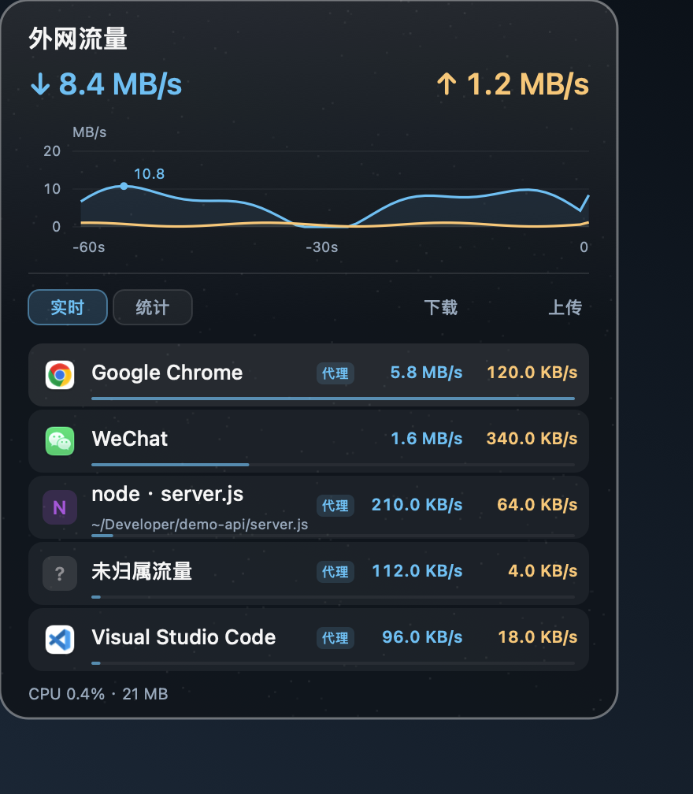
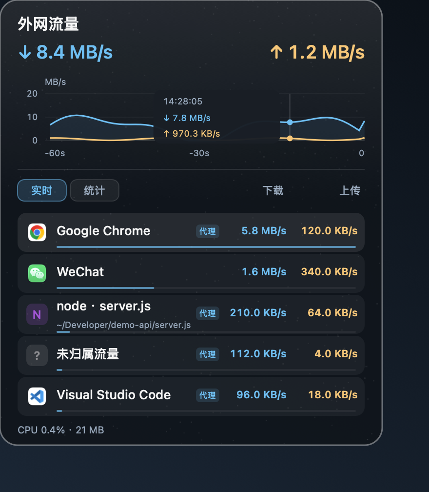

# NetBall

macOS 菜单栏网络流量监控。常驻显示实时上下行速率，也可查看流量曲线、进程排行和累计数据；支持可选悬浮球。

[下载最新版](https://github.com/gongfpp/NetBall/releases/latest) · [更新记录](https://github.com/gongfpp/NetBall/releases)

<p align="center">
  
</p>
<p align="center">
  
  
</p>
<p align="center"><sub>菜单栏图中的速率是截屏时的读数；展开面板为示例数据，均不代表当前实时流量。</sub></p>

## 功能

- 菜单栏实时显示下行、上行速率，支持多种紧凑样式。
- 悬停菜单栏图标即可展开面板：上下行曲线共用刻度，显示最近 60 秒；在曲线上移动指针可查看对应时刻的速率。
- 应用排行使用真实图标；Node 等脚本进程在名称下显示已采集的项目目录或脚本路径，长路径保留末尾，完整路径可悬停查看。普通应用不添加路径副行，代理流量使用紧凑标记。实时与累计列表保持相同布局和面板高度。
- 可选桌面悬浮球；显示模式可切换为菜单栏、悬浮球或两者同时显示。
- 无需 `sudo`、屏幕录制权限、辅助功能权限或网络扩展。

## 开始使用

### 下载应用

从 **v1.2.10** 起，发布包的最低部署目标为 **macOS 12.0**，仅支持 **Apple Silicon（arm64）**，直接使用不需要安装 Swift。已核对二进制中的真实最低版本并在 macOS 26 上通过构建与自检；尚未在 macOS 12–15 实机验证，不保证所有旧系统环境均无问题。v1.2.9 的旧下载包仍要求 macOS 26，使用较旧系统请下载 v1.2.10 或更新版本。

1. 从[最新 Release](https://github.com/gongfpp/NetBall/releases/latest) 下载 ZIP 包。
2. 解压，将应用放到固定位置后打开。程序常驻菜单栏，不显示 Dock 图标。
3. 悬停菜单栏图标展开面板，点击图标打开设置和退出菜单。

发布包使用 ad-hoc 临时签名，未经过 Apple 公证。若首次打开时被系统拦截，请先确认下载来源，再按 macOS「隐私与安全性」中的提示操作，不要关闭全局安全检查。

### 从源码编译

需要 Swift 编译器及 macOS SDK（可通过 Xcode Command Line Tools 安装）。构建脚本显式指定 `arm64-apple-macosx12.0`，并在打包前核对 Mach-O 的最低版本、架构及其与 `Info.plist` 的一致性，避免随开发机默认目标升高。在项目目录运行：

```bash
./build.sh
open NetBall.app
```

构建脚本会替换项目目录中的旧应用包。可选开机启动：编译后在项目目录运行[开机启动脚本](install-autostart.sh)：

```bash
./install-autostart.sh
```

应用移动位置后需重新运行该脚本。

### 更新与自检

更新时先从菜单退出旧版，再替换并打开新版；累计统计会重新起算，不保留历史。

从源码构建后，可运行本地自检：

```bash
./build/NetBall --stats-test
./build/NetBall --fmt-test
./build/NetBall --ease-test
```

自检覆盖统计、归属、身份路径、图表和提示区域等逻辑；后台系统悬停提示是否实际出现，仍需在应用中验证。

## 统计说明

- 顶部速率与累计总量通过 `NET_RT_IFLIST2` 读取 macOS 物理网卡的 64 位累计字节，避免旧 32 位计数在 4 GiB 回绕时丢失区间；不计本机回环和虚拟接口。同名接口更换或计数复位时重新建立基线，读取暂时失败则保留上一成功基线。累计从应用启动或手动重置开始，退出或重启后不保留。
- 应用明细将 mihomo / Clash Verge Rev 的代理连接流量归回原应用，与连接级直连流量去重；同一应用的多个进程合并显示。普通本机回环不计入，代理核心的外网字节不会再次相加；走本机代理但规则为 `DIRECT` 的连接也会归回原应用。
- 节能采样：网速独立刷新（展开时每秒），应用明细的 CPU 预算目标间隔为 2–30 秒，可在底部 CPU 悬停提示中查看；实际受网速档位、扫描用时与调度影响，可能更久，并非 CPU 硬上限。明细速率是扫描区间平均值，较短连接可能漏计，但物理网卡总量不受影响。
- 底部「CPU」均值为最近约 30 秒主程序与采集子进程的合计，100% 代表一个 CPU 核心；悬停可看拆分。内存数值仅指主程序，不包含子进程或 WindowServer。
- 无法确认具体应用的连接归为「未归属流量」；有代理链路时显示代理标记，悬停可查看 Clash 来源，不单独显示代理核心字节，以免重复计算。它可能包含 DIRECT 或无法匹配到本机进程的流量，不代表未知应用，也不是物理总量的剩余值。接口不可用时保守漏计，不按代理核心总量猜测分摊。
- 直连 UDP 支持有具体本地地址、端口且位于物理接口的未连接 socket（例如 UU 远程的 `*:*` 对端）；与同源代理连接去重。来源或 socket 身份有歧义时仍保守跳过，修复不会补算历史累计。
- 健康快照确认 socket 消失后，同进程复用端口不会继承旧代理覆盖；读取失败或身份歧义不视为关闭。代理计数以选中控制器的实例证据和请求开始窗口维护基线，不因无关代理核心重启而清空。进程启动时间优先读取 BSD 元数据，失败时尝试内核启动时钟；仍不可验证则保守跳过该区间，不按 PID 猜应用，也不补算历史。
- 明细包含代理有效载荷与直连 socket 字节，顶部是物理网卡字节，两者不保证相等；短连接、采样间隙、加密开销和隧道都可能造成差异。归属不是完整流量审计，不能把「未归属」当作物理总量减去明细之和。
