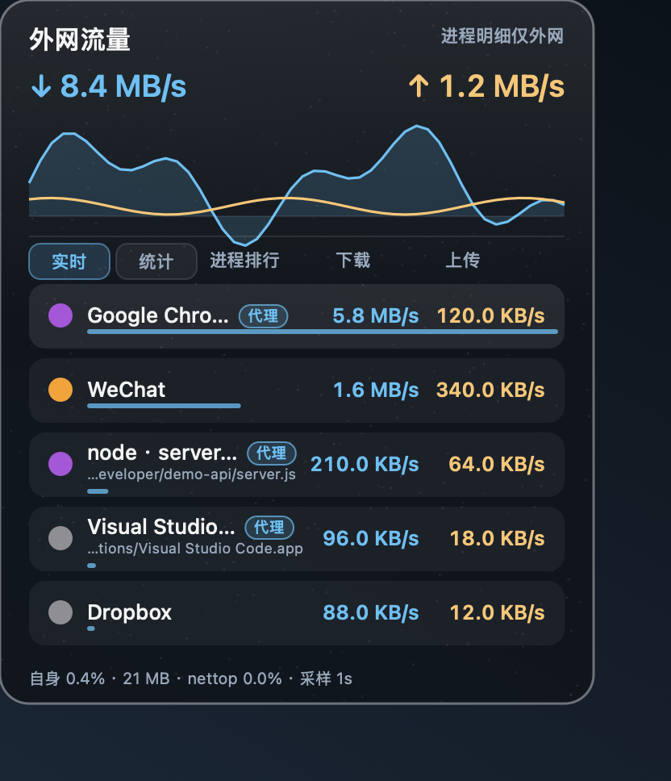

# NetBall

macOS 菜单栏网络流量监控。常驻显示实时上下行速率，也可查看流量曲线、进程排行和累计数据；支持可选悬浮球。

<p align="center">
  
</p>
<p align="center">
  
</p>
<p align="center"><sub>菜单栏图中的速率是截屏时的读数；展开面板为示例数据，均不代表当前实时流量。</sub></p>

## 功能

- 菜单栏实时显示下行、上行速率，支持多种紧凑样式。
- 悬停菜单栏图标即可展开面板，查看曲线、实时进程排行和按应用/项目汇总的统计。
- 可选桌面悬浮球；显示模式可切换为菜单栏、悬浮球或两者同时显示。
- 无需 `sudo`、屏幕录制权限、辅助功能权限或网络扩展。

## 开始使用

需要 **macOS 12 或更新版本**及 Swift 编译器。在项目目录运行：

```bash
./build.sh
open NetBall.app
```

点击菜单栏图标打开设置和退出菜单。可选开机启动：`./install-autostart.sh`；程序移动位置后需重新运行该脚本。

## 统计说明

- 顶部速率与累计总量读取 macOS 物理网卡计数；不计本机回环和虚拟接口。累计从应用启动或手动重置开始，退出或重启后不保留。
- 应用明细将 mihomo / Clash Verge Rev 的代理连接流量归回原应用，与连接级直连流量去重；同一应用的多个进程合并显示。普通本机回环不计入，代理核心的外网字节不会再次相加；走本机代理但规则为 `DIRECT` 的连接也会归回原应用。
- 节能采样：网速独立刷新（展开时每秒），应用明细的 CPU 预算目标间隔为 2–30 秒，显示在底部；实际受网速档位、扫描用时与调度影响，可能更久，并非 CPU 硬上限。明细速率是扫描区间平均值，较短连接可能漏计，但物理网卡总量不受影响。
- 底部「CPU均值」为最近约 30 秒主程序与采集子进程的合计，100% 代表一个 CPU 核心；悬停可看拆分。内存数值仅指主程序，不包含子进程或 WindowServer。
- 面板右上角显示代理归属状态。无法确认应用的代理流量列为「未归属代理流量」；接口不可用时保守漏计，不拿代理核心总量猜测分摊。仅自动探测本地常见 mihomo 控制接口，不支持的代理无法分摊到应用。
- 明细包含代理有效载荷与直连 socket 字节，顶部是物理网卡字节，两者不保证相等；短连接、采样间隙、加密开销和隧道都可能造成差异。归属不是完整流量审计，不能把「未归属」当作物理总量减去明细之和。
